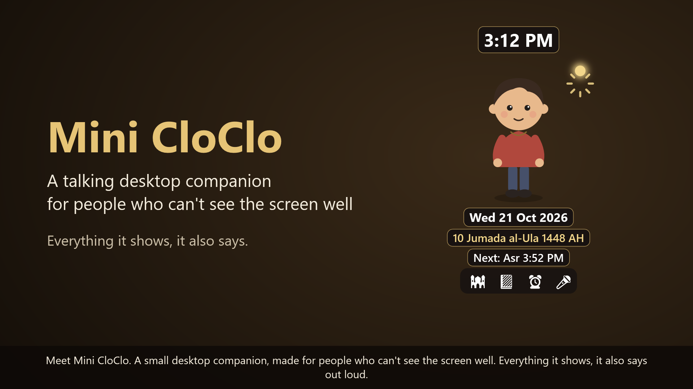
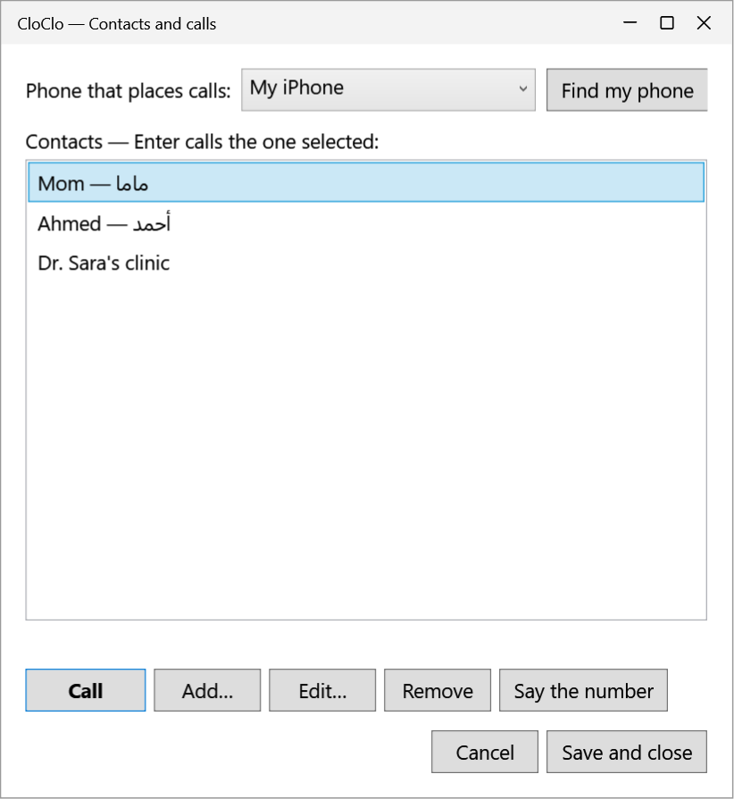
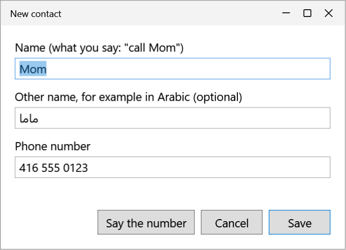
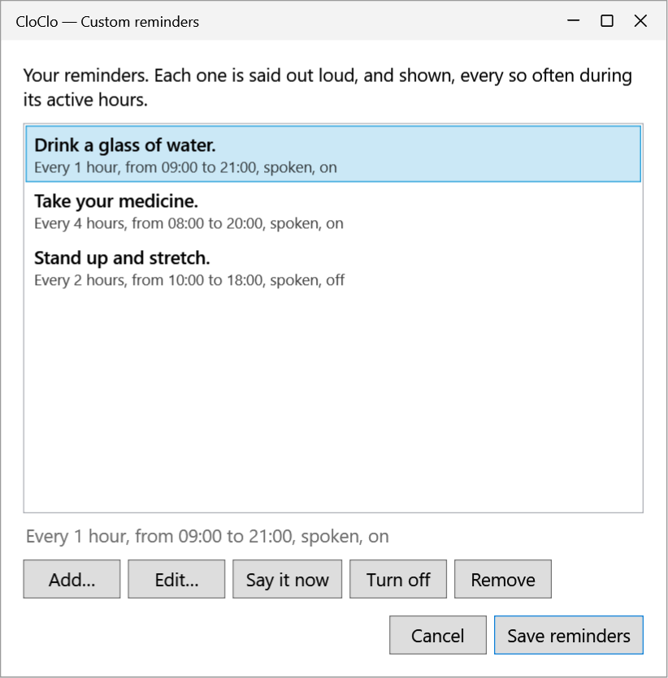
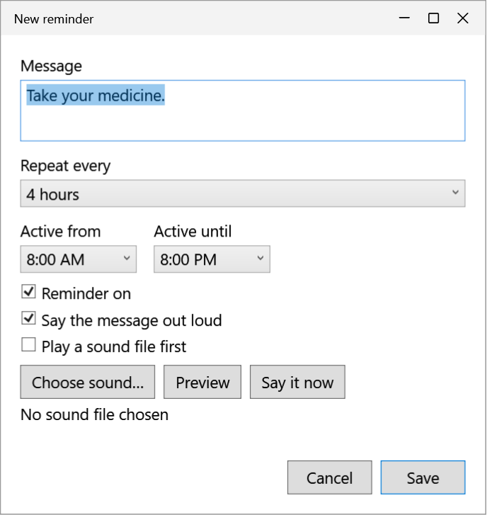
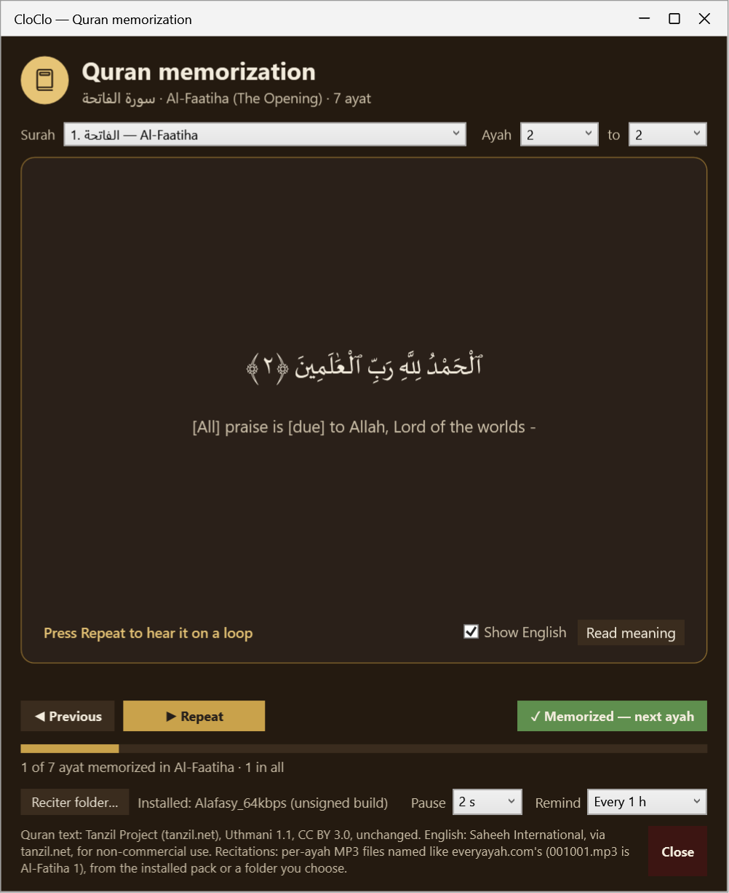

# Mini CloClo

A small, **offline** version of the CloClo desktop widget, made for someone who
can't see the screen well. It keeps only:

- **Voice commands** — talk to it instead of looking for it.
- **Custom reminders** — spoken out loud, on the clock; medicine reminders
  wait for "yes, I took it".
- **Prayer times and azan** — announced out loud, then the azan (a built-in
  recording, or your own).
- **Quran memorization** — recitation on a loop, controlled by keyboard or voice.
- **Calling** — "call Mom" places a call on your mobile phone over Bluetooth.
- **Your own questions and answers** — "Ramadan date", "when is Civic
  Holiday?": Islamic dates worked out on the PC, holidays and your own notes.
- **Pull** — "pull dates", "pull news": fresh dates or headlines, after "yes"
  (off until turned on).
- **Read aloud** — say "read": the text you selected in any app, or the text
  in a picture under the mouse, read in Arabic or English, on your PC.
- **Search and play** — "search YouTube", "search Spotify": the top results
  read aloud, and the one you choose played (off until turned on).
- **The avatar**, which changes with what's happening (prayer clothes, reading
  the Quran, reminder cardigan, pyjamas when asleep, a listening badge).
- **The time and date** — large, plus the Hijri date and the next prayer.

### What's new

- **[1.10](https://github.com/shaimaasultan/mini-CloClo-Widget/releases/tag/v1.10.0)** — **learns your mishearings**: when a
  command isn't understood and the next one works, Keeper offers to remember
  it ([Learning your mishearings](#learning-your-mishearings)); **settings
  kept per city**: each kind in its own named file and folder in
  `%LOCALAPPDATA%\MiniCloClo` (never Roaming), and going back to a city brings
  back its prayer times, reminders, questions and pull tools
  ([Where things are kept](#where-things-are-kept)).
- **[1.9](https://github.com/shaimaasultan/mini-CloClo-Widget/releases/tag/v1.9.0)** — **"read" reads pictures too**: with nothing
  selected, the text in the picture under the mouse (a scanned letter, a
  medicine box, a screenshot); **"read the screen"** / **"اقرا الشاشة"** reads
  the whole window — Windows' own text recognition, offline, Arabic or
  English. Just **"read"** / **"اقرا"** is enough. ([Read aloud](#read-aloud))
- **[1.8](https://github.com/shaimaasultan/mini-CloClo-Widget/releases/tag/v1.8.0)** — **read the selected text aloud**: the 🔊 icon,
  Ctrl+Alt+L or "read this".
- **[1.7](https://github.com/shaimaasultan/mini-CloClo-Widget/releases/tag/v1.7.0)** — each keyboard shortcut can be turned **on or off
  on its own**; no more Windows Security popup when searching Spotify.
- **[1.6](https://github.com/shaimaasultan/mini-CloClo-Widget/releases/tag/v1.6.0)** — **search and play** on YouTube or Spotify by voice;
  new promo videos.
- **[1.5](https://github.com/shaimaasultan/mini-CloClo-Widget/releases/tag/v1.5.0)** — reminders **on the clock** that wait their turn;
  **medicine reminders** that wait for "yes"; the next time beside each
  reminder.

## Watch it

[](https://github.com/shaimaasultan/mini-CloClo-Widget/releases/download/v1.6.0/MiniCloClo-promo.mp4)

▶ [Watch the video in English](https://github.com/shaimaasultan/mini-CloClo-Widget/releases/download/v1.6.0/MiniCloClo-promo.mp4) (2:53) ·
[شاهد الفيديو بالعربية](https://github.com/shaimaasultan/mini-CloClo-Widget/releases/download/v1.6.0/MiniCloClo-promo-ar.mp4) (3:33, narrated by Hoda).
Both have captions, so they work with the sound off. They're attached to the
[1.6 release](https://github.com/shaimaasultan/mini-CloClo-Widget/releases/tag/v1.6.0).

There is no weather, no location lookup and no internet in Mini CloClo
itself: the build fails if any code tries to go online
(`scripts/check-no-network.ps1`). The two features that need the internet
hand it to something else, after you say yes: [Pull](#pull) runs a separate
script, and [Search and play](#search-and-play) opens Edge or Spotify. The one
connection it can make is over Bluetooth, to your own paired phone, and only
while placing a call you asked for (see [Calling](#calling)). Everything it
shows is also spoken, and everything can be reached without the mouse. The
widget and every window have names and labels for screen readers such as
Narrator.

## Requirements

- Windows 10 version 2004 or later, or Windows 11, 64-bit.
- For voice commands: a microphone, and a processor with AVX2 and FMA (most
  from 2015 on). Without them everything else still works, by keyboard.
- **Optional, for faster voice commands:** an NVIDIA graphics card with about
  1.5 GB of free graphics memory and a current NVIDIA driver. Mini CloClo then
  runs the speech model on it (CUDA); without one it uses the processor, which
  answers a few seconds later.
- For calls: Bluetooth, and a mobile phone paired with the PC.
- About 1.6 GB of disk (the speech model is 574 MB; the graphics-card files
  another 700 MB). While running it uses roughly 1–1.5 GB of memory, most of
  it the speech model, which is kept loaded so commands start at once.
- To build it: the [.NET 10 SDK](https://dotnet.microsoft.com/download), and
  [Git LFS](https://git-lfs.com) for the recitations and videos.

## Install

First, once: double-click **`scripts\Get-SpeechFiles.cmd`**. It downloads the
files too big for the repository and checks each one's fingerprint
(SHA-256) before using it:

- the **Whisper large-v3-turbo** speech model (574 MB), from this
  repository's [speech-model-1 release](https://github.com/shaimaasultan/mini-CloClo-Widget/releases/tag/speech-model-1)
  (or the whisper.cpp models on Hugging Face);
- **NVIDIA's cuBLAS** (548 MB, from NVIDIA's 422 MB download), so the model
  can run on an NVIDIA graphics card. Without an NVIDIA card, add `-NoCuda`
  to skip it.

This is the only install step that goes online; Mini CloClo itself never
does. Then double-click **`scripts\Install-MiniCloClo.cmd`** (as yourself, not as
administrator). It builds Mini CloClo, installs it into
`%LOCALAPPDATA%\Programs\MiniCloClo`, adds Start Menu and desktop shortcuts,
makes it start with Windows and starts it. It needs no .NET installed to run —
it carries its own runtime.

- **Ctrl+Alt+C** opens Mini CloClo from anywhere (the shortcuts' key). If it
  is already running, it says so.
- **To update**, run the installer again: it closes the running copy, replaces
  it and keeps your settings, reminders, contacts and Quran progress.
- **To remove it**: `scripts\Uninstall-MiniCloClo.cmd` (your settings are kept;
  `uninstall.ps1 -RemoveSettings` removes them too).
- **Where your settings are:** `%LOCALAPPDATA%\MiniCloClo` — the local folder,
  which Windows never copies anywhere. Versions before 1.10 kept them in
  `%APPDATA%\MiniCloClo`; the installer (and the app, at startup) moves them
  across once, keeping any file already in the new folder.

**Quran recitations:** Mishary Alafasy's recitation of **Al-Fatiha and
Al-Baqara** (293 ayat, 57 MB, stored with Git LFS) comes with the project in
`Assets\Recitations\Alafasy_64kbps\`. The installer packs every per-ayah MP3
in `Assets\Recitations\<reciter>\`, named like everyayah.com's (`001001.mp3`
is Al-Fatiha 1), into one file beside the app. To learn other surahs with
sound, add their files to that folder (or a new reciter's folder) and run the
installer again — or choose a folder of recitations from inside the Quran
window. Ayat without a recording are shown as text.

**First thing to set:** your city, for the prayer times. Click the 🕌 icon, or
press Ctrl+Alt+M → *Prayer times and azan…*, and pick it from the list (or
choose *Another place* and type its latitude and longitude). On first run it
picks a listed city in the PC's time zone, or Cairo.

**Speech voices:** replies use Windows' own voices. English works out of the
box. For Arabic replies, add an Arabic voice in **Settings → Time & language →
Speech → Add voices** (Microsoft Hoda is Egyptian), then turn on *Voice and
speech → Voice commands and replies in Arabic*.

**Optional — let Windows enforce "offline":** double-click
`scripts\Block-MiniCloClo-Network.cmd` and approve the administrator prompt. It
adds two Windows Firewall rules that block all of `MiniCloClo.exe`'s network
traffic, in and out, whatever code inside it tries. Calls still work, because
Bluetooth isn't network traffic. Check the rules any time with
`scripts\Set-MiniCloCloFirewall.ps1 -Check`; remove them with `-Remove` from an
administrator PowerShell.

## Talking to it

Hold the **right mouse button anywhere for a second** (or press
**Ctrl+Alt+V**, or click the 🎤 icon), wait for the short rising chime — that's
when it starts listening — say a command and let go (or press Ctrl+Alt+V
again). A short right-click still works as usual. Talking to it stops a
recitation, the azan or speech that is playing, so "stop", "next" and
"previous" work while the Quran is being recited.

| Say | It does |
|---|---|
| What time is it? / الساعة كام | Says the time |
| The date / التاريخ | Says the date and the Hijri date |
| Next prayer / الصلاة الجاية | Says the next prayer, its time and how long until it |
| Prayer times / مواقيت الصلاة | Reads all of today's prayer times |
| Quran / القرآن | Opens the Quran window where you left off; with it open, plays or pauses the recitation |
| Quran surah / القرآن سورة (or "choose a surah") | Asks which surah, from which ayah and to which ayah, then opens and recites it ([Quran](#what-it-does-on-its-own)) |
| Next / اللي بعده | Marks the ayah memorized and moves to the next |
| Previous / اللي قبله | Goes back one ayah |
| Reminders / التذكيرات | Opens the reminders |
| Call Mom / اتصل بماما | Reads the contact's number back, then calls after "yes" ([Calling](#calling)) |
| Stop / اسكت | Stops the azan, a recitation or speech |
| Cancel / إلغاء | Cancels a call or a shutdown waiting for an answer |
| I prayed / صليت | Ends the prayer look |
| Help / مساعدة | Says the commands and shortcuts |
| Ramadan date / تاريخ رمضان (any of your own words) | Answers with what you entered, or the next date ([Questions and answers](#questions-and-answers)) |
| Again / قولها تاني | Says the last answer to your own question again |
| Did I take my medicine? / خدت الدوا؟ | Reads the medicine log: each dose today, taken (when) or missed |
| What topics do I have? / مواضيعي | Lists your topics |
| Forget that / انسى ده | Forgets the learned phrase just used ([Learning your mishearings](#learning-your-mishearings)) |
| Pull dates / اسحب التواريخ | Downloads fresh dates into your questions, after "yes" ([Pull](#pull)) — off until turned on |
| Pull news / اسحب الأخبار | Reads the latest headlines aloud, after "yes" ([Pull](#pull)) |
| Search / ابحث (or "search YouTube", "ابحث في سبوتيفاي") | Searches YouTube or Spotify, reads the top results and plays the one you choose ([Search and play](#search-and-play)) — off until turned on |
| Read / اقرا (or "read this", "اقرا ده", "read the picture") | Reads the text selected in any app aloud — or, with nothing selected, the text in the picture under the mouse ([Read aloud](#read-aloud)) |
| Read the screen / اقرا الشاشة (or "read the page") | Reads all the text in the window you're using, by text recognition |
| Pause the song, resume, next song, previous song / وقف الأغنية، كمل الأغنية، الأغنية الجاية، الأغنية اللي فاتت | Controls what Spotify or a video plays now |
| Open Notepad, Word, Calculator, Narrator, Magnifier, Settings | Opens that app |
| Shut down / اقفل الجهاز | Shuts the PC down, after asking about open apps ("cancel" stops it) |

Recognition runs on this PC with the Whisper **large-v3-turbo** model — on
an NVIDIA graphics card when there is one (CUDA), otherwise on the
processor; what you say is never saved or sent. On the graphics card each
command is decoded carefully (beam search over 5 candidates, the full audio
window), which mishears less; on the processor it is decoded the quick way,
so it still answers within a few seconds. When a command isn't understood, the label under the
icons shows **"Heard: …"** — what the recognizer wrote — which helps tell a
noisy microphone from a misheard word.

### Learning your mishearings

The speech model tends to mishear the same words the same way for one voice
("Paul dates" for "pull dates", "أسكوط" for "اسكت"). When a command isn't
understood and, within 30 seconds, the next one works, Keeper asks: *"Shall I
remember what you said before as another way to say the time? Say yes, or
no."* — it names only the command; the label shows *Heard: … → the time*.
Say **"yes"** / **"نعم"** and next time those same words simply do that
command; **"no"**, or another command, and nothing is kept.

- **What can be learned:** the built-in commands (the time, the Quran, read…),
  opening an app, your own question words, pull tools and "call …" (a call
  still asks "yes" before dialing). **Never** "cancel", "stop", "yes", "no" or
  shutting down.
- **Learned words are checked after every exact command**, before the
  sound-alike guesses, so a built-in phrase always means what it says.
- **"Forget that"** / **"انسى ده"** right after a learned phrase was used
  removes it; menu → **Learned phrases…** lists them all (*misheard → command*)
  with **Remove** and **Remove all**.
- **Only text is kept** — what was misheard, what worked and the command's
  name; never audio — in `%LOCALAPPDATA%\MiniCloClo\learned-phrases.json`, at most
  200 (the least recently used go first).

## Keyboard

**From any app**, with Ctrl+Alt:

| Ctrl+Alt + | |
|---|---|
| **T** | The time |
| **D** | The date (and Hijri date) |
| **P** | The next prayer |
| **A** | All of today's prayer times |
| **Q** | Quran memorization |
| **R** | Custom reminders |
| **K** | Contacts and calls |
| **I** | Questions and answers |
| **Y** | Medicine taken (answers "Did you take it?") |
| **V** | Talk (press again when done) |
| **L** | Read the selected text aloud (or the picture under the mouse) |
| **W** | Read the whole window aloud |
| **S** | Stop sounds |
| **M** | The menu (opens with the keyboard in it) |
| **H** | Help |

If another app already uses one of these, Mini CloClo says so and the rest
still work. **Each one can be turned on or off on its own**: menu → *Voice and
speech* → *Keyboard shortcuts (Ctrl+Alt)* lists them all, with *All
shortcuts* at the top to turn every one off or on at once. One turned off is
left free for other apps, and the spoken help names only those that work.

**On the widget**, once it has focus (click it, or open its menu): the same
letters without Ctrl+Alt, plus **Space** to talk, **Shift+P** for all prayer
times, **Shift+Q** to choose a surah, **F1** for help, **Shift+F10** or the menu key for the menu, **Enter**
for "I've prayed" at prayer time, and **Esc** to close the label.

In the **Quran window**: Ctrl+P (or F5) plays/pauses, Ctrl+→ marks memorized
and moves on, Ctrl+← goes back, Ctrl+I says where you are, Ctrl+M reads the
English meaning. The buttons in its windows have Alt access keys (the underlined letter).

## Calling

Mini CloClo can call your saved contacts through your mobile phone over
Bluetooth, without Phone Link. Tested with an iPhone.

1. Pair the phone once in **Windows Settings → Bluetooth & devices**.
2. Press **Ctrl+Alt+K** (or menu → *Contacts and calls…*), choose **Add** for
   each person — the name you'll say, optionally another name such as the
   Arabic one, and the number — and **Find my phone**. Save.
3. Say **"call Mom"** (or "اتصل بماما"). CloClo reads the number back and asks;
   talk to it again and say **"yes"** — in Arabic **"نعم"** — (or "cancel" /
   "لا") within 45 seconds. A reply
   that starts with yes ("yes, call her") counts; one with "no" or "cancel"
   never does. In the window, select a contact and press **Enter** to call
   straight away.

| Contacts and calls (Ctrl+Alt+K) | Adding a contact |
|---|---|
|  |  |

How it works: CloClo connects to the phone's hands-free service, the way a car
kit does, sends one dial request, and disconnects. The phone places the call
on its own line, and **the call's sound is on the phone** (or a headset paired
to the phone), not the PC; you hang up on the phone. The phone needs to be
nearby, unlocked and with Bluetooth on. If the PC's Bluetooth was off, CloClo
turns it on for the call and back off afterwards (Windows must allow apps to
control radios: **Settings → Privacy & security → Radios**); if it was on (a
Bluetooth headset in use), it leaves it on. Only saved contacts can be called,
and a voice call is always confirmed first. The window (Ctrl+Alt+K, Enter)
is always there as the dependable way when a name keeps being misheard.

## Questions and answers

Your own questions, by **topic**: each topic holds **words you say** —
*Ramadan*, *Civic Holiday*, *Clinic* — and Keeper answers each one with:

- **text** you typed, read exactly as written ("Dr. Sami's clinic is open
  Sunday to Thursday, 9 to 5");
- **dates** — the next one, its weekday and how far away it is, with the
  Hijri date: "Civic Holiday. In 284 days, on Monday, August 2, 2027, 29 Safar
  1449";
- a **Hijri date** — worked out on the PC every year with Windows' Umm
  al-Qura calendar (it may differ by a day from a local moon sighting):
  "Ramadan. In 109 days, on Monday, February 8, 2027, 1 Ramadan 1448."

**Islamic dates** come ready-made: Isra and Mi'raj, Shab-e-Barat, Ramadan,
Laylat al-Qadr, Eid al-Fitr, Dhul Hijjah, Hajj, Arafah, Eid al-Adha, the
Islamic new year and Ashura, each with its Arabic name.

**Asking:** say the word, or "Ramadan date", "when is Ashura?", "how many
days until Eid?", "date of Hajj", "تاريخ رمضان", "رمضان امتى؟", "فاضل قد ايه
على العيد؟". "Eid" / "العيد" answers both Eids. A word misheard by a sound
("Laylat al-Kodim", "A surah" for Ashura) still finds it. Say a topic's name
to hear what's in it, "what topics do I have?" / "مواضيعي" for the list, and
**"again"** / **"قولها تاني"** to hear the last answer again (for 5 minutes).

**Editing:** **Ctrl+Alt+I** (or menu → *Questions and answers…*). Topics are
on the left and their words on the right: *Add…* / *Edit…* asks for the word
(and another way to say it, e.g. in Arabic) and the kind of answer; *Say the
answer* tries it. Words that are already commands ("time", "Quran", an app's
name, "call …") can't be used. *Export…* / *Import…* share the list as a
file; importing a topic with the same name replaces it.

**Published dates from the internet** (optional, outside the app):
double-click `tools\questions-and-answers\Get-CalendarTopics.cmd`, give your country (e.g. `CA`)
and province (e.g. `CA-ON`), and it saves *CloClo calendar <year>.json* in
your Downloads folder with this year's and next year's Islamic dates
([Aladhan](https://aladhan.com), the Saudi official calendar by default) and
public holidays ([Nager.Date](https://date.nager.at)). Import it with
*Import…*: it replaces *Islamic dates* with the published dates, and adds
*Public holidays*. Mini CloClo itself still never goes online — only this
script does, when you run it; run it again each year.

## Pull

**"Pull dates"** / **"اسحب التواريخ"** fetches fresh data by voice, with no
window: a **pull tool** goes online, and its result is added to Questions and
answers — or, for tools that make one, read aloud.

1. Say **"pull dates"** ("what can I pull?" lists the tools; "pull" alone
   works when there is one).
2. Keeper asks first: *"Pull dates? This goes online to download Islamic
   dates and public holidays. Talk to me again and say yes, or cancel."*
3. *"Running the dates tool."* … *"Importing the file."* … *"Import done."* —
   then the topics added or updated and their words, ready to ask about
   ("Ramadan date"). "Again" repeats it. If something goes wrong, Keeper says
   what (no internet, too slow, nothing returned).

The tools that come with it:

- **dates** — Islamic dates and public holidays, added to Questions and
  answers. Left empty, the country and province come from your
  **prayer-times city** (Mississauga → Canada, Ontario: national holidays
  plus Family Day and the Civic Holiday), else from Windows' "Country or
  region" setting. Settings: country (e.g. `CA`; `none`: no holidays),
  province (e.g. `CA-ON`), the Islamic calendar method, and how many years.
- **news** — the latest headlines, read aloud: *"Here it is. CBC Top
  Stories. 5 items. 1: … Say a number to hear more."* Then say a headline's
  number — "two" / "اتنين" — to hear that story's summary; another number
  reads another (for 5 minutes). "Again" repeats, "stop" stops. Settings:
  the English feed (CBC Top Stories) and the Arabic feed (BBC Arabic), used by
  the voice commands' language, and how many headlines (1–10). Any RSS or
  Atom feed address (`https://…`) works.

"Pull" is often heard as "Bull" or "Paul": a word that sounds like it,
followed by a tool's name, counts.

**Pull commands are off until you turn them on**, because the tools go
online: menu → **Pull tools…** → *Allow pull commands (they go online)*. The
same window sets each tool's settings.

**Mini CloClo itself still never goes online.** It only starts a tool from
the `tools\pull` folder beside the app — never anything you said — after you say
yes, and reads the file the tool writes. Its own network check and the
firewall rules for `MiniCloClo.exe` are unchanged; the tools are separate
PowerShell scripts.

**Adding a tool** (later: news, trends…): a folder `tools\pull\<name>\` with
`tool.json` — its spoken name (`name`, `otherName`), what it goes online for
(`description`, `otherDescription`), `"result": "import"` or `"read"`,
`timeoutSeconds`, and its `settings` with `settingLabels` — and `run.ps1`,
which is run as `run.ps1 <settings file> <result file>`. The settings file
holds the tool's `settings`, `"language": "en"` or `"ar"` (the voice
commands' language) and `"place"`: the prayer-times city, its country code
and, where holidays differ by region, its province or state
(`{ "city": "Mississauga", "country": "CA", "region": "CA-ON" }`). An `import` tool
writes a list of topics (the same file *Import…* reads); a `read` tool
writes `{ "title": "...", "items": [ { "text": "...", "otherText": "..." } ] }`
(up to 10 items, read aloud in order).

## Read aloud

Select text in **any app** — a web page in Edge, an email, a Word document, a
PDF, Notepad — then click the **🔊 icon** on the widget, press **Ctrl+Alt+L**,
or hold right-click and say **"read"** / **"اقرا"** ("read this", "اقرا ده"
work too; holding the button doesn't clear the selection), or use the menu:
*Read the selected text aloud*. Keeper reads it aloud:

- **Arabic or English, by itself:** Arabic with the Arabic voice (Hoda) and
  English with the English one (David); a text with both is read with both,
  whatever the voice-command language.
- **"Stop"** stops it; **"again"** reads it once more; a reminder pauses it
  and it carries on from the sentence it was on.
- Up to about 20,000 characters (a select-all of a long document reads the
  beginning).

**Text in pictures, too.** With **nothing selected**, "read" / 🔊 / Ctrl+Alt+L
reads the text in the **picture under the mouse pointer** — a scanned letter,
a photo of a medicine box, a screenshot, an image on a web page — or, when the
pointer isn't on a picture, the page in that window. **"Read the screen"** /
**"اقرا الشاشة"** (or *"read the page"*, Ctrl+Alt+W, or the menu's *Read the
whole window aloud*) reads all the text in the window you're using. The text
is found with **Windows' own text recognition (OCR)**, on your PC: each line
is recognized in English and in Arabic, and the reading with more letters of
its own script wins (Arabic lines are put in right-to-left order). The widget
hides for that moment so its own clock isn't read; the picture is captured in
memory only and let go. Arabic needs the Arabic language added in Windows
(*Settings → Time & language → Language*), which brings its text recognition.
Nothing found: Keeper says so.

**Offline, on your PC only.** The text is taken the way Narrator does it —
Windows UI Automation asks the app for its selection — and read by Windows'
own voices. For an app that doesn't share its selection that way, Mini CloClo
copies it (Ctrl+C) and puts back what the clipboard held; if Windows'
clipboard history (Win+V) is on, that copy is kept in it. Clicking the widget
makes it the active window, so it remembers the last app you used before it
and reads from that one. Nothing is saved.

## Search and play

Search **YouTube** or **Spotify** and play what you choose, without seeing
the screen:

1. Say **"search"** / **"ابحث"**. Keeper asks *"Which app? YouTube or
   Spotify?"* — or say **"search YouTube"** / **"ابحث في سبوتيفاي"** to skip
   that question.
2. *"What should I search for?"* — say the words, in Arabic or English
   (*"عمرو دياب بابا"*).
3. Keeper reads them back: *"Search YouTube for Amr Diab Baba? Say yes, or no
   to say it again."* A mishearing is caught here; nothing is searched
   before "yes".
4. The app opens on its results and Keeper reads **the top 5** — YouTube:
   *"1: Amr Diab - Baba, from Rotana, 3 minutes."*; Spotify: *"1: Getlak, by
   Amr Diab."* Ads, playlists ("Mix") and Shorts are skipped.
5. *"Which one should I play? Say the number."* — **"two"** / **"اتنين"**
   (or "play the first one", "شغل التاني"); **"again"** reads the list again.
6. *"Play number 2, Baba?"* — **"yes"** plays it; **"no"** asks which one
   again. For a few minutes after, **"next"** / **"التالي"** plays the next
   result, or say another number. **"Cancel"** stops the search at any step.

While a song or video plays: **"pause the song"**, **"resume"**, **"next
song"**, **"previous song"** (*"وقف الأغنية"*, *"كمل الأغنية"*, *"الأغنية
الجاية"*, *"الأغنية اللي فاتت"*) — through Windows' media controls, like the
keyboard's media keys.

**Turn it on first:** menu → **Search YouTube and Spotify** → *Allow search
(opens Edge or Spotify)*; the same menu sets how many results are read (1–5).
YouTube opens in **Microsoft Edge**; Spotify in the **Spotify app** you are
already signed into (the Microsoft Store one or Spotify's own installer). No
account or key is needed for Mini CloClo.

**How it reads the results:** the way Narrator does — Windows UI Automation,
which is part of Windows. Mini CloClo finds the results in the app by what
they are (YouTube's video links, Spotify's song rows), reads them, and
presses the one you chose wherever it is on the screen — not a recorded click
at a fixed place. It only reads what the app already shows, subscribes to no
events and changes no setting; the results are let go a few minutes after one
plays. If they can't be read (the page didn't load, the app changed), Keeper
says so and leaves the app open on them, for someone to choose by hand or
with Narrator. The results are recognized by the English wording YouTube and
Spotify use ("3 minutes, 19 seconds", "Play … by …"), so those apps should be
in English; the songs and videos themselves can be in any language.

**Mini CloClo itself still never goes online.** It builds the search address
(the words, encoded) and hands it to Edge or Spotify, which go online as they
do when you search by hand. Edge must be Microsoft-signed, and Spotify is
reached only through its own package (or its installer's exe, signed by
Spotify) — not any program that claims the `spotify:` address.

## What it does on its own

- **Prayer times** are worked out on the PC (Egyptian, Umm al-Qura, Muslim
  World League, Karachi or ISNA; Standard or Hanafi Asr). At each prayer it
  says "It's time for the Asr prayer", then plays the azan — the built-in
  recording from `Assets\Azan`, or your own chosen with *Choose azan audio…*
  (*Use built-in* goes back) — and the avatar changes into prayer clothes on a
  prayer mat until you say "I prayed" (or click the green check or the head).
  It can also warn you 5–30 minutes before each prayer (10 by default).
  Prayers missed while the PC was asleep or off aren't announced late.
- **Custom reminders** (up to 10): a message, how often (15 minutes to 4
  hours) and active hours. Each is spoken, and can play a sound file first.
  Open them with the ⏰ icon, Ctrl+Alt+R or by saying "reminders"; **Add**
  makes a new one and **Say it now** tries it out. Each one shows when it
  comes next (*"Next: today at 3:00 PM"*), and the list is in that order:
  the next one at the top, those turned off at the bottom.

  They come **on the clock**: at the start hour and every interval after it
  (every hour from 9 → 9:00, 10:00…; every 90 minutes → 9:00, 10:30,
  12:00…), also across midnight. A restart or reinstall doesn't reset them;
  one missed while the PC was asleep is said once if it was due in the last
  15 minutes. **Nothing is cut off:** reminders, the hourly time and the
  Quran review wait their turn and what is due together is said as one —
  *"It's 3:00 PM. Reminders: drink a glass of water. Take your medicine."* —
  and they wait, instead of being lost, while the azan plays, a recitation is
  on, Keeper is speaking or you're answering a question (a reminder waits up
  to an hour, the hourly time 5 minutes).

  **Medicine reminders** wait for an answer: turn on *Wait for an answer (for
  medicine)* in a reminder, choose how often to ask again (5–15 minutes) and
  for how long (30 minutes–2 hours), and pick its times (every 6, 8, 12 or 24
  hours, e.g. 8:00 and 20:00). At its time Keeper rings the bell twice and
  asks *"Blood pressure tablet. Did you take it? Say yes, or later."* — and
  again every few minutes until **"yes" / "نعم"** (logged as taken, with the
  time; also **Ctrl+Alt+Y**). **"Later" / "بعدين" / "not yet" / "لسه"** asks
  again in 10 minutes, **"cancel"** stops asking (logged as skipped), and when
  the time runs out the dose is logged as **missed**. Ask **"Did I take my
  medicine?"** (or "…this morning?", "When did I last take my medicine?",
  "خدت الدوا؟") to hear the log. It's kept 30 days in
  `%LOCALAPPDATA%\MiniCloClo\medicine-log.json`, on this PC only. Answering
  stops a Quran recitation only for that moment: it carries on from the same
  ayah after Keeper's reply.

  | Your reminders | Adding a reminder |
  |---|---|
  |  |  |

- **Quran**: the Uthmani text with the English meaning, recited ayah by ayah
  on a loop from the installed recitations or a folder you choose. It
  remembers what you've memorized, and can remind you to review every 30
  minutes to 2 hours. Open it with the 📗 icon, Ctrl+Alt+Q or by saying
  "Quran"; **Repeat** (Ctrl+P) plays the ayah on a loop and **Memorized —
  next ayah** (Ctrl+→) moves on.

  **Choose a surah by voice:** say **"Quran surah"** (or "القرآن سورة",
  "choose a surah", "اختار سورة", or just "surah"), and Keeper asks three
  questions — plain "Quran" never asks them — each answer
  is its own hold of the right button after the chime:
  1. *Which surah?* — its number ("2") or name ("Al-Baqara", "the Cow",
     "البقرة"). Keeper says it back: "Surah Al-Baqara, 286 ayat."
  2. *From which ayah?* — a number, or **"all"** ("the whole surah", "كلها")
     to recite the whole surah from the first ayah to the last, starting again
     from the first when it ends.
  3. *To which ayah?* — a number, or "to the end". The Quran window opens on
     those ayat and recites them on a loop (up to 20 ayat at a time; a longer
     run is shortened to 20, and Keeper says so).

  Numbers are said **digit by digit**, and Keeper asks for them that way:
  "one four" is 14, "one seven" 17, "two three four" 234 ("واحد أربعة",
  "اتنين تلاتة أربعة"). Ten short digit words are far easier to hear than
  "fourteen" or "seventeen". Only those ten words are matched by sound
  ("tree" for three, "سبات" for سبعة), so other speech is asked again rather
  than guessed at. "14" said whole still works when it is heard right.
  With voice commands in Arabic, the digits may be said in Arabic **or in
  English** — "واحد أربعة" or "one four": each answer is read both ways, and
  the reading that is just a number is used.

  An unclear answer is asked again (the label shows what was heard). If
  Keeper reads back the wrong surah or ayah, say **"no"** (or "back", "لا",
  "ارجع") to go back one question and answer it again — at the first
  question, "no" stops. "Cancel" stops the questions at any time. The menu has *Choose a surah by voice…*, and
  Shift+Q starts it when the widget has focus.

  
- **The time every hour**, if you turn it on (*Voice and speech*).

Reminders keep coming while the avatar is asleep (after the *Sleep after*
time with no keyboard or mouse use), since not touching the PC doesn't mean
nobody is listening. They wait only while the prayer look is on, until "I
prayed".

## The widget

The time sits on top, large, with the sun by day and the moon at night: from
sunrise and sunset in your city when it's in the PC's time zone, otherwise
6 AM to 6 PM by the PC's clock. Below the avatar are the date, the Hijri date
and the next prayer, each on a dark plate that reads on any wallpaper. Under
them, five icons: 🕌 prayer times, 📗 Quran, ⏰ reminders, 🎤 talk, 🔊 read the
selected text aloud, and a
label for messages — click it to hear it again, or its ✕ to close it. Click
the head to hear the time; drag to move the widget; right-click or
double-click for the menu. *Look → Size* makes it 1×, 1.5× (default) or 2× as
large.

The menu also has the avatar (Keeper or Lady Keeper) and outfit colour,
motion, when it falls asleep, speaking speed, the startup greeting, always on
top and start with Windows. The **tray icon** (by the clock) has the same
menu, plus *Hide/Show the widget*; double-click it to hide or show the widget —
hidden, it keeps working and its shortcuts too.

## Troubleshooting

| What happens | What to do |
|---|---|
| Nothing is spoken | Check the volume and that a Windows voice is installed (Settings → Time & language → Speech) |
| "Voice commands need a newer processor" | The PC lacks AVX2/FMA; use the keyboard shortcuts |
| "Listening stopped" / "Didn't hear a command" | Check the default microphone (Settings → System → Sound), and speak after the chime |
| A command isn't understood | Look at "Heard: …" on the label; speak a little slower, closer to the microphone |
| "Some shortcuts are taken" | Another app uses that Ctrl+Alt key; the rest still work |
| "Couldn't reach your phone" | Phone nearby, unlocked, Bluetooth on; in Contacts and calls, *Find my phone* again |
| Phone Link says "blocked by your system administrator" | Not needed: calls go straight over Bluetooth |
| Install or uninstall says a file is in use | Choose *Exit* from Mini CloClo's menu and run it again |

## Where things are kept

Everything is in `%LOCALAPPDATA%\MiniCloClo` (`C:\Users\<you>\AppData\Local\MiniCloClo`),
each kind of setting in its own file, named for what it holds. Settings that
belong to a place have a folder per place, and each tool has its own folder
under `tools`:

```
MiniCloClo\
  settings.json, location.json, contacts.json, quran-progress.json,
  medicine-log.json, learned-phrases.json, errors.log
  prayer-times\mississauga-ca\settings.json
  reminders\mississauga-ca\settings.json
  tools\
    questions-and-answers\mississauga-ca\settings.json
    pull\settings.json
    pull\news\mississauga-ca\settings.json, result.json
    pull\dates\mississauga-ca\settings.json, result.json
    search\settings.json
  backups\
```

| File | What it holds |
|---|---|
| `%LOCALAPPDATA%\MiniCloClo\settings.json` | How the widget looks and behaves: size, avatar and outfit, motion, window position, always on top, sleep; voice and speech (hold to talk, Arabic, speed, greeting, hourly time); keyboard shortcuts |
| `%LOCALAPPDATA%\MiniCloClo\location.json` | The place in use: `City`, `Latitude`, `Longitude`, `LocationTimeZoneId` |
| `%LOCALAPPDATA%\MiniCloClo\prayer-times\<place>\settings.json` | Prayer times for that place: calculation and Asr method, azan on/off and sound, announcements, the reminder before each prayer, the prayer look |
| `%LOCALAPPDATA%\MiniCloClo\reminders\<place>\settings.json` | Your custom and medicine reminders for that place |
| `%LOCALAPPDATA%\MiniCloClo\tools\questions-and-answers\<place>\settings.json` | Your topics and answers for that place (Islamic dates, its public holidays, your notes, the dates a pull brought in) |
| `%LOCALAPPDATA%\MiniCloClo\tools\pull\settings.json` | Pull commands on or off (the same in every place) |
| `%LOCALAPPDATA%\MiniCloClo\tools\pull\<tool>\<place>\settings.json` | That pull tool's options for that place (news feeds, holidays country...) |
| `%LOCALAPPDATA%\MiniCloClo\tools\pull\<tool>\<place>\result.json` | What that tool's last pull brought |
| `%LOCALAPPDATA%\MiniCloClo\tools\search\settings.json` | Search on/off and how many results are read |
| `%LOCALAPPDATA%\MiniCloClo\contacts.json` | Contacts (names and numbers, in plain text) and the paired phone |
| `%LOCALAPPDATA%\MiniCloClo\quran-progress.json` | Quran memorization progress |
| `%LOCALAPPDATA%\MiniCloClo\medicine-log.json` | The medicine log (30 days) |
| `%LOCALAPPDATA%\MiniCloClo\learned-phrases.json` | Learned mishearings (text only) |
| `%LOCALAPPDATA%\MiniCloClo\errors.log` | Error log (exception types only, no text you said or typed) |
| `%LOCALAPPDATA%\MiniCloClo\backups\` | Copies kept when the settings were reorganized, e.g. `settings-2026-10-24-before-medicine.json` |

**Settings per place.** `<place>` is the city and its country, e.g.
`mississauga-ca`, `london-gb` (typed-in coordinates without a name use the
coordinates). Each settings file in a place folder starts with the place it
belongs to:

```json
"Location": { "City": "Mississauga", "Latitude": 43.59, "Longitude": -79.64, "LocationTimeZoneId": "Eastern Standard Time" }
```

When you change the city (*Prayer times and azan…*), a place you've used
before brings back its own prayer times, reminders, questions and pull tool
options — Keeper says so — and a new place starts from the ones you had; the
old place's folders stay as they were. Look, voice, shortcuts, contacts,
search, pull on/off, Quran progress, the medicine log and learned phrases are
the same everywhere. A pull tool's folder appears the first time you set its
options or pull with it, and is kept when you turn it off.

Until 1.10 everything was in one `settings.json`; the first time the new
version starts it is moved into these files and folders, and the old file is
kept in `backups` (`settings-<date>-before-split.json`). Files from an
in-between build (`prayer-times_<place>.json`, `pull-tools_<place>.json`,
`search.json`, the `pull` results folder) are moved into the folders too, a
copy kept in `backups\settings-<date>-before-folders`. `quran.json` is
renamed `quran-progress.json`.

All of it is in `%LOCALAPPDATA%\MiniCloClo` — paste that into File
Explorer's address bar to open it. Nothing else is written: audio from the
microphone stays in memory and is dropped after each command.

## Project layout

- `src/Views/` — the widget (`MainWindow*.cs`, `KeeperView`) and its windows:
  prayer times, Quran, reminders, contacts and calls.
- `src/Services/` — prayer times and the offline city list, Quran text and
  progress, speech and the listening chime, the azan library, settings.
- `src/Platform/` — voice commands and call matching, search and play
  (`SearchVoiceCommand`, `MediaSearch`), the right-button hook,
  the Bluetooth dialer, single instance, startup and shutdown.
- `scripts/` — install, uninstall, recitation packing, the offline check and
  the firewall rules.
- `src/config/` — the app manifest (DPI awareness, Windows versions).
- `tools/questions-and-answers/Get-CalendarTopics.ps1` (and `.cmd`) —
  downloads published Islamic dates and public holidays into a file to import
  in Questions and answers (the one part that goes online, run by hand or by
  "pull dates").
- `tools/pull/` — the pull tools, installed beside the app in `tools\pull`:
  `tools/pull/dates/` runs the calendar script with the settings from *Pull
  tools…*, `tools/pull/news/` reads the headlines.
- `tools/promo-video/` — makes the promo videos, offline: scenes drawn with the
  app's own avatar, narration by a Windows voice, encoded by Windows.
  `PromoVideo.exe <output.mp4>` for English, add `--arabic` for Arabic. It
  hides the account name the avatar shows on its shirt. The videos are in
  `docs/video/`, stored with Git LFS, and attached to each release — the
  README links the release copies, whose downloads don't use the LFS
  bandwidth allowance.

Debug builds have these test switches:

- `MiniCloClo.exe --snapshot <folder>` draws every avatar look to PNG files.
- `--voice-test <file>` speaks test commands with a Windows voice and runs
  them through the recognizer.
- `--prayer-test <file>` writes today's times, sunrise and sunset for a few
  cities.
- `--topics-test <file> [import file]` checks the questions and answers: the
  answers, the Hijri dates, what is said, words that clash with commands —
  and, with a file, imports it into the window.
- `--quran-test <file>` plays a whole surah and a range in the Quran window.
- `--settings-test <file>` splits an old one-file `settings.json` into the named
  files and folders, moves to London and back to Mississauga, checks each
  place's settings come back, and moves an in-between build's flat files into
  their folders, in a throwaway folder.
- `--learn-test <file>` learns a mishearing on a real (muted) widget — offered,
  learned, used, forgotten — and checks what is never learned and the limit.
- `--ocr-test <file>` shows a picture of English, then Arabic, text and
  reads it back with text recognition.
- `--selection-test <file> [copy]` reads the text selected in the active app
  (UI Automation, or with `copy` by copying it) and checks the clipboard is
  put back.
- `--search-test <file>` checks the search phrases, the app and number
  answers, the music controls, and reading results from saved YouTube links
  and Spotify buttons (offline).
- `--search-live <youtube|spotify> <words> <file>` opens the app on a search
  and reads the top results, with the reader's timings — nothing is played.
- `--pull-test <file> [real]` runs local test pull tools (import, read, a
  failure, a time-out, no result — none goes online) and checks what is said;
  with `real`, the dates tool also runs once.
- `--voice-test <file> [text] [--model <ggml file>]` runs only the spoken
  phrases containing that text, and can compare another model; every
  recognition is timed.
- `--engine-check <file>` says whether the speech model runs on the graphics
  card or the processor, and times loading it and one recognition.
- `--load-trace <file>` records which part of the app loads any networking
  library (only WPF's startup and Windows' speech voices do, and none of them
  connects anywhere).
- `--bt-test <file> <phone> [number]` connects to the paired phone and does
  the hands-free handshake — with a number it also dials it and checks the
  call outlives the disconnect.

## License

Mini CloClo's code and artwork are under the [MIT License](LICENSE),
© 2026 Shaimaa Said Soltan — shaimaasultan@hotmail.com ·
[github.com/shaimaasultan](https://github.com/shaimaasultan).

The Quran text, its English meaning, the recitations, the azan and the speech
model are others' work under their own terms — some for non-commercial use
only — listed in [THIRD-PARTY-NOTICES.md](THIRD-PARTY-NOTICES.md).

## Credits

Built from the full CloClo widget (`C:\cloclo-widget`). The Quran text is the
[Tanzil Project](https://tanzil.net)'s verified Uthmani text (CC BY 3.0) and
the English meaning is Saheeh International's, as published by Tanzil, both
unchanged. The recitations are Mishary Alafasy's, from
[everyayah.com](https://everyayah.com), included for personal, non-commercial
use; all rights in them remain with the reciter. The built-in azan is recited by Aaqib Azeez. Speech
recognition: [whisper.cpp](https://github.com/ggerganov/whisper.cpp) through
Whisper.net.
